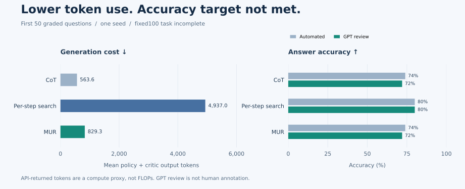
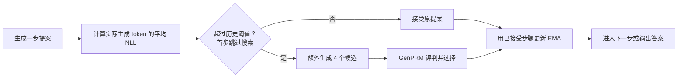

<div align="center">
  
  <p>
    <a href="https://arxiv.org/abs/2507.14958v5"></a>
    <a href="https://github.com/yayayacc/MUR"></a>
    <a href="#reproduce"></a>
    <a href="#results"></a>
  </p>
  <p><strong>用可复算的实验证据，检验选择性搜索能否节省计算并保持准确率。</strong></p>
  <p><a href="#results">实验结论</a> · <a href="#method">方法概览</a> · <a href="#reproduce">快速复算</a> · <a href="#evidence">证据与代码</a> · <a href="#reference">论文与引用</a></p>
</div>

# MUR · 独立最小复现

这是论文 **Momentum Uncertainty guided Reasoning for Large Language Models** 的独立复现项目，聚焦 **Qwen3-1.7B + MATH-500 子集**，比较 CoT、逐步 Guided Search 和 MUR。只进行推理，不训练、不做参数搜索。

> [!IMPORTANT]
> **当前证据未支持“省计算且基本不掉点”。** 前 50 道完整评分题中，MUR 相比逐步搜索节省 **83.2% 输出 token**，但自动评分准确率低 **6 个百分点**，GPT 复核后低 **8 个百分点**。预设 100 题任务因阶段时限中止；这不是完整 MATH-500 复现，也不是作者官方结果。

<a id="results"></a>
## 01 · 实验结论



图表直接由[已审查统计](experiments/mur-20261024-test100-r2/supervisor-statistics.json)生成，绘图代码见 [make_readme_figure.py](scripts/make_readme_figure.py)。

### 相同 50 题，三种方法

| 方法 | 自动评分 | GPT 复核¹ | 平均输出 token² | 相对逐步搜索节省 |
|:---|---:|---:|---:|---:|
| **CoT** | 74% · 37/50 | 72% · 36/50 | 563.60 | 88.58% |
| **逐步 Guided Search** | 80% · 40/50 | 80% · 40/50 | 4,936.96 | — |
| **MUR** | 74% · 37/50 | 72% · 36/50 | 829.30 | **83.20%** |

¹ GPT 复核是隐藏方法名后的答案等价性检查，**不是人类标注**。发现一处共享判分错误，影响 CoT 和 MUR 各一条标签；原始自动标签与复核标签均保留。

² 统计所有 policy + critic 的 API 返回输出 token，包括被丢弃的提案、四个候选以及 critic 的分析与判定。最终答案评分器单独计费。**Token 是计算代理指标，不等于 FLOPs 或 GPU 加速比。**

本项目预先规定的点估计目标是：**token 至少减少 40%，准确率下降不超过 2 个百分点**。结果只满足计算节省条件；同一子集上，CoT 比 MUR 更省，准确率相同。

| MUR − 逐步搜索 | 点估计 | 配对 bootstrap 95% 区间 |
|:---|---:|---:|
| 输出 token 节省 | 83.20% | 76.26% ～ 88.44% |
| 自动准确率差 | −6 个百分点 | −18 ～ +6 个百分点 |
| GPT 复核准确率差 | −8 个百分点 | −20 ～ +2 个百分点 |

统计采用 10,000 次题目级配对重采样，种子 `20261024`。两个准确率区间都不能支持预设的非劣性结论；区间仅描述已完成子集，未补偿资源中止造成的缺失。

<details>
<summary><strong>展开：65 题补充分析、完成度与资源记录</strong></summary>

100 题清单在生成前冻结，按四批、每批 25 题执行。前两批完成生成与自动评分；第三批在约 49 分钟的生成阶段时限处中止，第四批未启动。没有根据分数提前停止，也没有换题。

- **50 题**：三种方法均有自动评分，并已逐条复核。
- **65 题**：三种方法均完成生成，195 个答案均已作 GPT 复核。
- **196 条完整轨迹**：另有 1 条未形成配对的 CoT 轨迹，只计入成本。
- 新增 15 题**没有自动评分**，不能与前 50 题自动结果混为一谈。

| 方法 | 65 题 GPT 复核正确数 | 平均输出 token |
|:---|---:|---:|
| CoT | 44/65 | 675.55 |
| 逐步 Guided Search | 46/65 | 5,807.17 |
| MUR | 42/65 | 1,126.05 |

这项单独列出的补充分析中，MUR 节省 **80.61% token**，准确率低 **6.15 个百分点**，仍未达标。

两次驱动尝试合计 **7,946.44 秒，约 2.21 个 GPU 分配小时**，包括一次模型加载前失败和重复工程检查。已保存的生成 token 合计**至少 514,815**；中断轨迹的未落盘调用使精确总量不可得。此前准备阶段与本轮合计计费约 3.90 小时，部分历史数值为保守预算占用，不能全部当作实测时间。

详见[完整审查](experiments/mur-20261024-test100-r2/review.md)和[两次尝试的成本核对](experiments/mur-20261024-test100-r2/supervisor-resource-reconciliation.json)。

</details>

<a id="method"></a>
## 02 · 方法概览

MUR 用生成 token 的平均负对数概率衡量一个提案步骤的不确定性，再与历史已接受步骤的偏差修正 EMA 比较。只有超过阈值时，才额外生成候选并调用过程奖励模型选择下一步。



| 方法 | 搜索频率 | Critic 调用 |
|:---|:---|:---|
| CoT | 不搜索 | 无 |
| 逐步 Guided Search | 每一步，包括首步 | 每个候选一次分析与一次判定 |
| MUR | 不确定性触发时；首步不触发 | 仅在触发时评判四个候选 |

搜索分支会生成**原提案之外的四个新候选**，原提案的 token 同样计入成本。候选选择根据 critic 实际 Yes/No 判定 token 的概率进行，不访问参考答案。

<details>
<summary><strong>展开：不确定性与动量公式</strong></summary>

提案步骤的不确定性为实际生成 token 在原始模型分布下的平均 NLL，而非完整分布的熵：

$$m_t=-\frac{1}{L_t}\sum_{j=1}^{L_t}\log p_\theta(y_{t,j}\mid x,y_{<t},y_{t,<j}).$$

历史状态只用已接受步骤更新：

$$U_t=\alpha U_{t-1}+(1-\alpha)m_t^{\mathrm{accepted}},\qquad U_0=0.$$

当 $t>1$ 时，搜索触发条件为：

$$m_t^{\mathrm{proposal}}>\frac{U_{t-1}}{1-\alpha^{t-1}}-\log\gamma.$$

本轮固定 $\alpha=\gamma=0.9$。首步不搜索，完成选择后更新 EMA 一次。实现见 [mur/control.py](mur/control.py)，具体解释与数值验证的失败记录见 [PROTOCOL.md](PROTOCOL.md)。

</details>

<a id="reproduce"></a>
## 03 · 快速复算

**只需 Python 3.10+ 和标准库**，无需 GPU、模型权重或原始题目即可从脱敏逐题数据重新计算表格和置信区间。

```bash
git clone https://github.com/Flutter-Misdreavus/mur-reproduction.git
cd mur-reproduction

python3 scripts/recompute_supervisor.py \
  experiments/mur-20261024-test100-r2/supervisor-rows.json
```

输出分别包含 `primary_automated_scored_subset`（50 题自动评分）、`secondary_reviewed_same_scored_subset`（同 50 题复核）和 `supplementary_reviewed_all_complete_pairs`（65 题补充复核）。

可将结果保存在已忽略的本地运行目录：

```bash
mkdir -p runs/local-analysis
python3 scripts/recompute_supervisor.py \
  experiments/mur-20261024-test100-r2/supervisor-rows.json \
  --output runs/local-analysis/statistics.json
```

无需模型的控制器检查与发布审计：

```bash
python3 -m unittest discover -s tests -p test_control.py -v
python3 -m unittest discover -s tests -p test_public_audit.py -v
python3 scripts/audit_public.py --history
```

<details>
<summary><strong>重新生成图表 / 重新运行模型实验</strong></summary>

图表生成额外依赖 Matplotlib；不需要运行模型：

```bash
python3 -m pip install matplotlib
python3 scripts/make_readme_figure.py
```

重新运行模型实验需要另建任务及环境，不应直接续跑已失败的历史任务：

1. 阅读 [PROTOCOL.md](PROTOCOL.md) 与[本轮审查](experiments/mur-20261024-test100-r2/review.md)，区分原始 full500 设想、冻结的 fixed100 任务和实际完成子集。
2. 按 [configs/sources.json](configs/sources.json) 中的固定 revision 与哈希准备模型、数据，按[环境记录](experiments/mur-20261024-test100-r2/environment.json)核对依赖。
3. 使用独立实验工作区，先修复中断时逐调用成本的落盘问题、对齐内外层截止时间，再冻结新任务的样本、参数、资源上限和唯一 `run_id`；不要根据已观察测试分数调参。
4. 在远程 GPU 环境中完成数值验证与开发集工程检查，通过后再执行新任务。历史驱动器保留在 [scripts/test_stage_driver.py](scripts/test_stage_driver.py)，其预算、设备和任务校验不是通用的一键启动配置。

完整契约测试在具备固定依赖的远程环境中运行：`python -m unittest discover -s tests -v`。部分检查依赖已安装的 vLLM，不能把它们当作纯标准库测试。

</details>

## 04 · 固定实验配置

| 组件 | 本轮设置 |
|:---|:---|
| Policy | Qwen/Qwen3-1.7B · BF16 · 非 thinking 模式 |
| 过程评判 | GenPRM/GenPRM-1.5B |
| 最终答案评分 | TIGER-Lab/general-verifier · 与推理成本分开统计 |
| 数据 | 固定版本 MATH-500；打乱 500 个索引后预先选定 100 题 |
| 开发数据 | 与全部测试题去重的 20 道 MATH 训练题 |
| 随机种子 | 生成 `42`；样本选择与 bootstrap `20261024` |
| MUR | `alpha=0.9` · `gamma=0.9` · 偏差修正 EMA · 4 候选 |
| Policy / critic 采样 | `temperature=0.6` · `top_p=0.8` · `top_k=20` · `presence_penalty=1.5` |
| 生成上限 | 每步 2,048 token；最多 20 步；已接受轨迹最多 16,384 token |
| 推理环境 | Python 3.10.12 · PyTorch 2.6.0 · Transformers 4.51.3 · vLLM 0.8.5 |
| 硬件 | 单张共享 RTX 3090；各方法均关闭 prefix caching |

完整参数见 [core.json](configs/core.json)，来源固定信息见 [sources.json](configs/sources.json)，测试题身份与顺序见 [test-manifest.json](experiments/mur-20261024-test100-r2/test-manifest.json)。共享 GPU 上的墙钟耗时仅作描述，不用来声称受控加速比。

<a id="evidence"></a>
## 05 · 证据与代码

| 想了解什么 | 从这里开始 |
|:---|:---|
| 结论、失败原因与限制 | [最终审查](experiments/mur-20261024-test100-r2/review.md) |
| 自动结果与 GPT 复核的区别 | [统计结果](experiments/mur-20261024-test100-r2/supervisor-statistics.json) · [逐题数值与标签](experiments/mur-20261024-test100-r2/supervisor-rows.json) |
| NLL、触发与候选选择是否一致 | [账目与机制检查](experiments/mur-20261024-test100-r2/supervisor-ledger-checks.json) |
| 超时、重试有没有计入成本 | [成本核对](experiments/mur-20261024-test100-r2/supervisor-resource-reconciliation.json) · [尝试记录](experiments/mur-20261024-test100-r2/run-attempts.md) |
| 实验在什么条件下运行 | [环境记录](experiments/mur-20261024-test100-r2/environment.json) · [冻结任务](experiments/mur-20261024-test100-r2/task.json) |
| 开发阶段通过了什么检查 | [开发集审查](experiments/mur-20261024-prep-r6/review.md) |

```text
mur/          推理、动量控制、critic、评分与数据身份校验
configs/      参数、来源 revision、数值验证配置
scripts/      阶段驱动、统计复算、发布审计与 README 绘图
tests/        控制器、预算、数据划分、评分与审计回归检查
experiments/  脱敏配置、数值指标、失败摘要与审查记录
assets/       README 横幅及由指标生成的图表
```

**运行版本与报告版本分开记录：**

| 阶段 | Commit |
|:---|:---|
| 实际测试推理 | [`5c91a8a`](https://github.com/Flutter-Misdreavus/mur-reproduction/commit/5c91a8a178e2c39ba6aa50c3d116524eae8ecf6e) |
| 运行后统计修复与执行者报告 | [`e3e12dd`](https://github.com/Flutter-Misdreavus/mur-reproduction/commit/e3e12dd06dc9ca64b29c086c52248a13e1b52eb8) |
| 独立复核与累计成本核对 | [`f1d87df`](https://github.com/Flutter-Misdreavus/mur-reproduction/commit/f1d87df26c1283ae4f33eab05e136aa4d7612f60) |

后续文档或发布提交不是模型运行版本。仓库只包含代码及脱敏证据，不包含凭据、私有连接信息、题目与答案原文、权重、运行环境或原始 DSH 会话日志。

## 06 · 边界与后续工作

当前证据的边界：**单种子、部分完成、资源中止、GPT 答案复核**。早期跨引擎与独立 prefill 数值验证失败仍保留；后续原始生成概率契约检查通过，不代表那些失败的检查也通过。被选中候选的 NLL 只保留均值，无法逐 token 独立重算其均值。

后续优先处理：

- [ ] 在每次模型调用后保存成本，使中断轨迹也能完整计费。
- [ ] 对齐内层运行时限与外层清理时限，重新规划每批预算。
- [ ] 在开发数据上核对与论文实现的差异，不在已观察测试题上选参数。
- [ ] 冻结新的完整评估计划；在此之前不扩大到 full500 或宣称复现成功。

<a id="reference"></a>
## 07 · 论文与引用

本项目是独立实现与实验记录，**不是作者官方仓库**。阅读的论文版本为 [arXiv:2507.14958v5](https://arxiv.org/abs/2507.14958v5)，2026-05-24；官方代码参考为 [yayayacc/MUR](https://github.com/yayayacc/MUR)，固定提交 `5cc34676f1a0d0515b7940260cdde98a69f2b671`。

<details>
<summary>论文引用 · BibTeX（所读 v5 版本）</summary>

```bibtex
@misc{yan2026mur,
  title        = {MUR: Momentum Uncertainty guided Reasoning for Large Language Models},
  author       = {Hang Yan and Fangzhi Xu and Rongman Xu and Yifei Li and
                  Jian Zhang and Haoran Luo and Xiaobao Wu and Anh Tuan Luu and
                  Haiteng Zhao and Qika Lin and Jun Liu},
  year         = {2026},
  howpublished = {arXiv:2507.14958v5},
  url          = {https://arxiv.org/abs/2507.14958v5}
}
```

</details>

项目尚未单独指定代码许可证。论文、模型、数据和上游代码的授权以各自来源为准；本仓库不转发论文 PDF、原始数据、模型权重或上游源码树。
